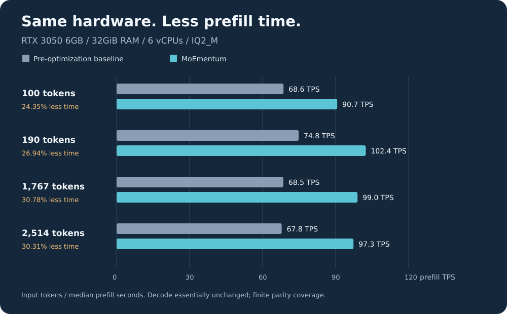
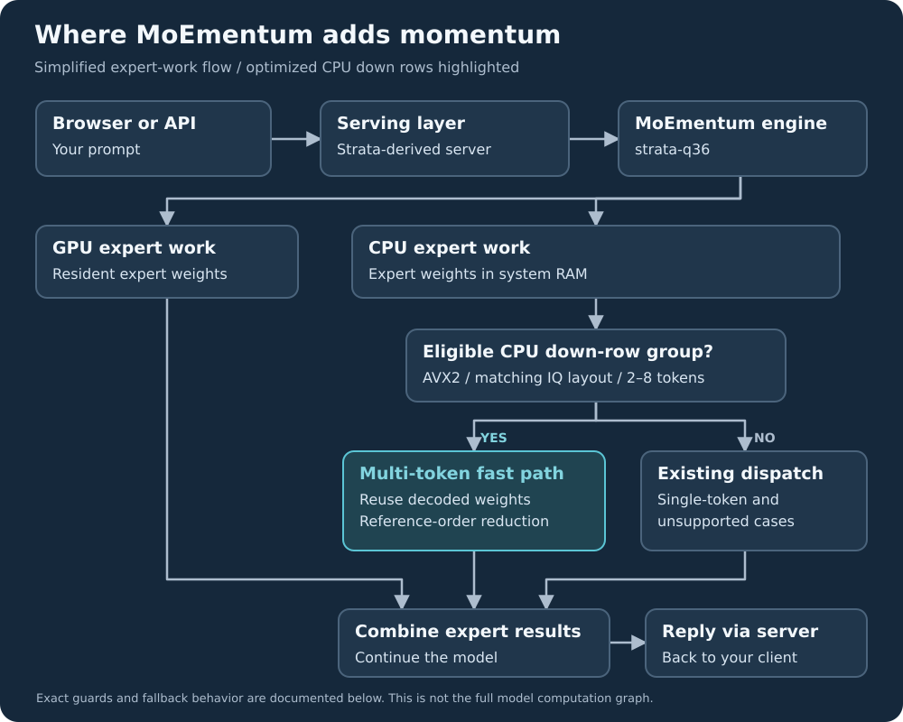

<p align="center">
  
</p>

<p align="center">
  <a href="LICENSE"></a>
  
  
  <a href="https://github.com/Niko1221/Strata"></a>
</p>

<h3 align="center">A small GPU. A team of experts. Less time reading your prompt.</h3>

**MoEmentum is an experimental [Strata](https://github.com/Niko1221/Strata) fork focused on faster mixture-of-experts prefill on consumer hardware.** Our tested setup runs Qwen3.8-35B-A3B-Distill IQ2_M with an **RTX 3050 6GB and 32GiB RAM**. It shares expert work between GPU and CPU, with a narrowly guarded optimization for CPU expert down-projections.

> **Integration branch:** this source integrates fork `main` at `e88ee39d1d6be6e3364183af3b39b62a7ed6f211`. The measurements below describe the earlier qualified source, **not this merged engine**. GPU builds, model parity and before/after performance are pending. See [source integration status](docs/MOEMENTUM_MAIN_INTEGRATION.md).

- **Measured, not projected:** 38.4–39.8 tokens/s generation and 101.4–102.4 tokens/s prompt processing in two served workloads (three samples each).
- **Faster prefill:** 24.35–30.78% less prefill time than our pre-optimization Strata-based baseline across four controlled tasks. Decode was essentially unchanged.
- **Usable interface:** browser Chat, Monitor and About views, plus the inherited OpenAI-compatible API. A private authenticated TLS deployment was validated.
- **Source-first:** no qualified MoEmentum binary release or one-click installer yet. Build this fork explicitly; inherited installers can download upstream binaries instead.

<p align="center"><a href="#how-fast-is-it">Performance</a> · <a href="#how-does-it-work">Engine</a> · <a href="docs/MOEMENTUM_INSTALL.md">Build & run</a> · <a href="docs/MOEMENTUM_BENCHMARK.md">Benchmark evidence</a> · <a href="#credits-and-license">Credits</a></p>

> This is not a new model or an official Strata release. Results below are from **our hardware and our model**, not Strata's larger-model homepage benchmarks. No stock llama.cpp speed comparison is claimed.

## What you need

Our measured configuration—not a universal minimum:

| Component | Tested setup |
| --- | --- |
| GPU | NVIDIA GeForce RTX 3050, 6GB VRAM (6,144MiB) |
| CPU | Intel Core i7-8700 @ 3.20GHz, as reported inside the guest |
| Guest | Linux / KVM, 6 vCPUs, 32GiB RAM |
| CPU expert workers | 5 threads |
| Model | Qwen3.8-35B-A3B-Distill, IQ2_M GGUF, about 12.56GB |
| Runtime | Context 4,096 · prompt chunk 128 · expert VRAM budget 3GiB · hybrid rows 128 · MTP off |

The optimized path requires AVX2/FMA/F16C and a matching IQ2_S/IQ3_S expert layout. The new dispatch excludes AVX-512 CPUs. Other models, CPUs and platforms are not covered by these measurements. The full model does **not** fit inside 6GB VRAM; system RAM matters.

## How fast is it?

**TPS = tokens per second.** Prefill reads the prompt; decode writes the answer. They measure different stages and must not be added together.

### Running through the API

Measured through an authenticated TLS endpoint using the deployed optimized binary, after warm-up. Three serial requests per workload, no reused prompt tokens, no speculative decoding.

| Workload | Input → output tokens | Reads prompt | Generates answer | Whole HTTP request |
| --- | ---: | ---: | ---: | ---: |
| Short generation | 71 → 128 | **101.4 TPS** | **38.4 TPS** | 4.169s |
| Long prefill | 1,763 → 23 | **102.4 TPS** | **39.8 TPS** | 17.951s |

All values are medians. The short workload hit its 128-token cap; the long workload stopped naturally. Stage TPS excludes other stages, model loading and HTTP overhead: **39.8 TPS is not end-to-end request throughput**. These are small observational samples, not multi-user capacity or a quality score.

```text
Prompt processing — one block ≈ 5 TPS
Short  ████████████████████  101.4 TPS
Long   ████████████████████  102.4 TPS

Answer generation — one block ≈ 2 TPS
Short  ███████████████████   38.4 TPS
Long   ████████████████████  39.8 TPS
```

The two panels use different scales. [All six sanitized samples and methodology](docs/MOEMENTUM_SERVING.md) · [Machine-readable data](docs/moementum/serving.json).

### What did our optimization change?

A **separate controlled trial**, not the API workloads above: same checkpoint, calibrated placement and runtime settings; three fresh processes per arm, order `A,C,C,A,A,C`, four tasks per process, no KV reuse.

<p align="center"></p>

| Input tokens | Baseline prefill | MoEmentum prefill | Less prefill time |
| ---: | ---: | ---: | ---: |
| 100 | 68.6 TPS | **90.7 TPS** | 24.35% |
| 190 | 74.8 TPS | **102.4 TPS** | 26.94% |
| 1,767 | 68.5 TPS | **99.0 TPS** | 30.78% |
| 2,514 | 67.8 TPS | **97.3 TPS** | 30.31% |

TPS is calculated as input tokens divided by median engine prefill seconds, using unrounded sample data. The baseline is the tested **pre-optimization Strata-based build**, not today's upstream release. A reduction in time is not the same percentage as an increase in TPS.

**Correctness boundary:** all emitted sequences matched across 24 requests and 918 token occurrences, including EOS. However, **both engines passed only 1 of the 4 unique tasks**. Preserving an answer does not make it correct. Decode was essentially unchanged; no generation speedup is claimed. Fixed ordering and three repeats do not establish statistical significance.

[Full experiment, hashes and limitations](docs/MOEMENTUM_BENCHMARK.md) · [Original sample data](docs/moementum/benchmark.json).

## How does it work?

Strata provides the inference engine, CPU/GPU expert execution and serving layer. MoEmentum changes one narrow piece: **how matching CPU expert down-projections process groups of tokens during prefill**.

<p align="center"></p>

Think of an expert's weights as a reference book. When several prompt tokens need the same expert, the multi-token kernel can decode its weights once for the group rather than repeating that work separately. Reference-order reduction preserves GGML-reference output bits on the inputs we exercised.

The new dispatch is guarded to IQ2_S/IQ3_S down rows with `n_embd=2048`, `n_ff=512`, and token groups `2..8`. Single-token and unsupported layouts retain their existing dispatch paths. Gate/up arithmetic, model weights and routing algorithms are not changed by this optimization. MTP is disabled in all results shown here.

[Kernel and fallback details](docs/MOEMENTUM_BENCHMARK.md#source-lineage). The branch also inherits mixed-expert compatibility work and a separate default-off Q4 diagnostic experiment; the latter was disabled in these measurements.

## Install and run

**Build the optimization branch**, not the upstream-tracking `main`:

```bash
git clone --branch moementum/iq-down-prefill https://github.com/CrashxZ/MoEmentum.git
cd MoEmentum
```

Continue with the **[Linux + NVIDIA build and launch guide](docs/MOEMENTUM_INSTALL.md)**. It includes CUDA prerequisites, the actual `strata-q36` build, model/tokenizer preparation, a runnable server configuration, and CPU-only regression tests.

> `./setup.sh` and `START-HERE.bat` are inherited from Strata and may fetch an upstream binary. They are **not a qualified MoEmentum installation path**. Our private deployment succeeded, but the generic clean-checkout guide has not been independently qualified end-to-end as an installer.

The executable and `STRATA_*` variable names remain unchanged for compatibility. Both CPU translation units affected by the inline-header change must be recompiled; a normal full CMake build handles that dependency.

## Using it

Once you have built the engine, supplied a model and written your configuration as described in the guide:

```bash
python serve/server.py --engine strata --config moementum.local.json \
  --host 127.0.0.1 --port 8080
```

- **Browser:** `http://127.0.0.1:8080` — Chat, Monitor and About.
- **OpenAI-compatible clients:** `http://127.0.0.1:8080/v1` — configure the server's model name and API key if enabled.
- **Network access:** keep loopback as the default. Add authentication and TLS before opening access beyond the machine. Port 8444 is our deployment's proxy choice, not a required engine port.

[Build, config and API notes](docs/MOEMENTUM_INSTALL.md#5-optional-browser-ui--api) · [Inherited API documentation](docs/DETAILS.md).

## Validation and limits

- **CPU numerical regression:** 10,368 comparisons, zero bit mismatches and zero preservation failures for the submitted kernel. The unchanged kernel failed with 3,644 mismatches. [Run it yourself](docs/MOEMENTUM_INSTALL.md#cpu-only-regression-test).
- **Full-engine parity:** finite task coverage, not proof of universal bit identity or model accuracy.
- **Served deployment:** authenticated models, completion, streaming and restart smoke checks passed in a private Linux/NVIDIA setup. No public weights, credentials or private deployment bundle is shipped.
- **Not qualified here:** Windows/AMD/Mac, other model layouts, multi-user saturation, a one-click installer, a MoEmentum binary release, or a stock llama.cpp performance comparison.

## Contributing

Use [MoEmentum issues](https://github.com/CrashxZ/MoEmentum/issues) for fork-specific problems. Include hardware, source revision, model/quantization, runtime settings, reproducible steps and unedited timing samples. Separate prompt processing from answer generation and report failures as well as wins. Remove tokens, private paths and user prompts before sharing logs.

## Credits and license

- **Strata:** Niko1221 and contributors. Its history and original [MIT license](LICENSE) are preserved. [Upstream README snapshot](README.upstream.md) · [Current upstream project](https://github.com/Niko1221/Strata).
- **llama.cpp / GGML:** quantized formats and reference arithmetic; retain their included notices and licenses.
- **MoEmentum:** experimental kernel/dispatch work and validation by **Mainak Mondal**, with AI-assisted development.
- Model weights and third-party dependencies retain their own licenses. Fork branding does not imply upstream endorsement.
